# TalkAI

A mobile app for practicing spoken English with an AI partner in real-life scenarios. You pick a situation (a taxi ride, a coffee shop, a job interview), talk to the AI out loud over a live voice call, and get structured feedback on your grammar, fluency and vocabulary when the call ends.

Built with Expo / React Native, a Django backend, the OpenAI Realtime API and Supabase as a 4-week internship MVP.

**[Download the APK](../../releases/latest)** (Android, see [Running the APK](#running-the-apk) before installing)

<p align="center">
  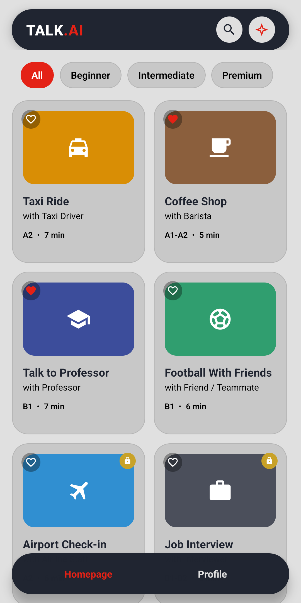
  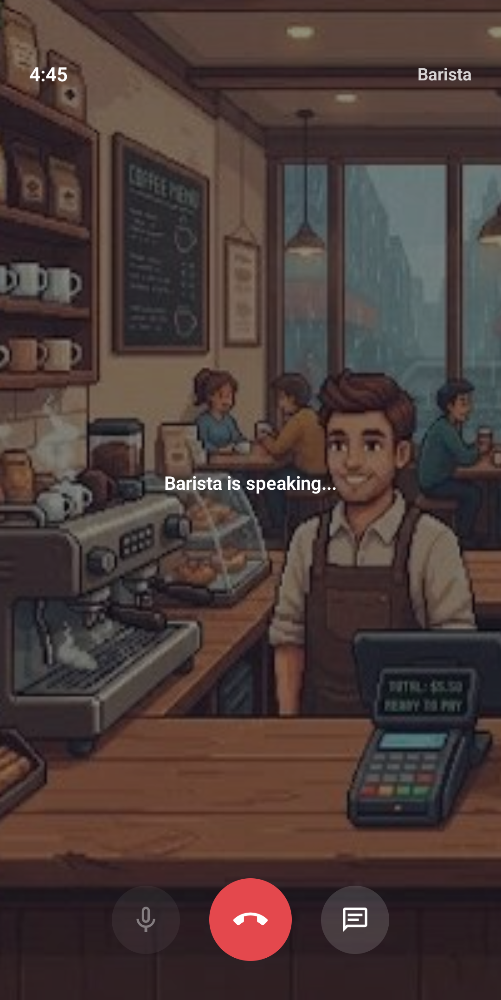
  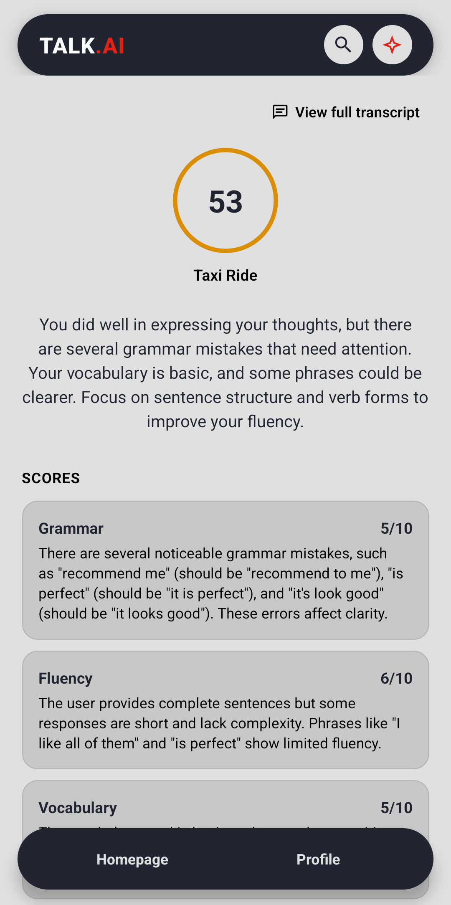
</p>

## Features

- **Live voice conversation** with an AI role-play partner over WebRTC, using push-to-talk (hold to speak, release to send)
- **Live transcript** during the call, and the full transcript again on the Feedback and History screens
- **Post-session feedback**: scores for grammar, fluency and vocabulary, corrections, better expressions and a short summary
- **6 scenarios** from A1 to B2, with a level filter and a search bar on the home screen
- **Accounts** with email and password. Browsing scenarios is free, practicing requires an account
- **Favorites**, synced between the home grid, the scenario page and the profile
- **Profile** with average score, per-skill averages, favorites and session history
- **Premium paywall** that unlocks the Airport Check-in and Job Interview scenarios
- **Daily reminder** push notification for users who haven't practiced in 24 hours
- **Product analytics** for sign-ups, sessions, feedback views, paywall views and purchases

## Screenshots

### Browsing and signing in

|                     Home                      |                  Scenario detail                  | Sign in | Paywall |
|:---------------------------------------------:|:-------------------------------------------------:|:---:|:---:|
| 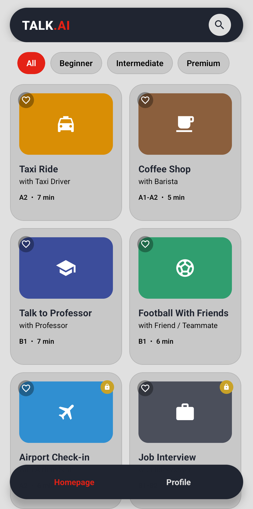 | 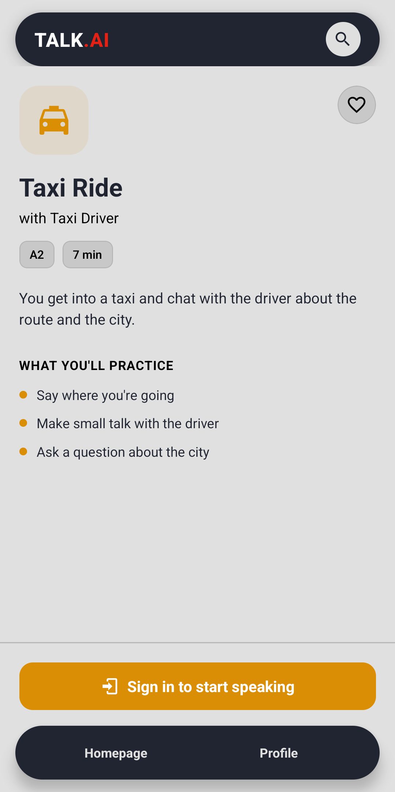 | 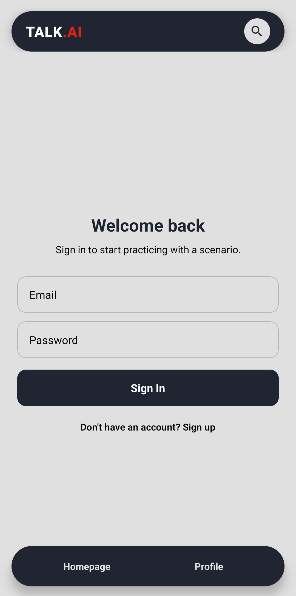 | 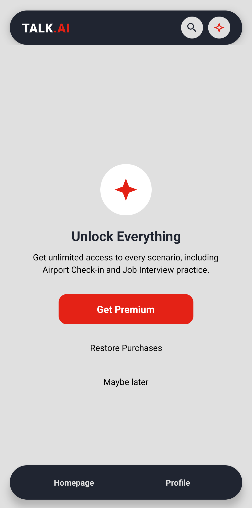 |
|      Scenario catalog, open to everyone       | Goals of the scenario, sign-in required to start  | Email and password | Premium scenarios via RevenueCat |

### Practicing

|               Scenario (signed in)                |                   Live call                   |                Live transcript                |
|:-------------------------------------------------:|:---------------------------------------------:|:---------------------------------------------:|
| 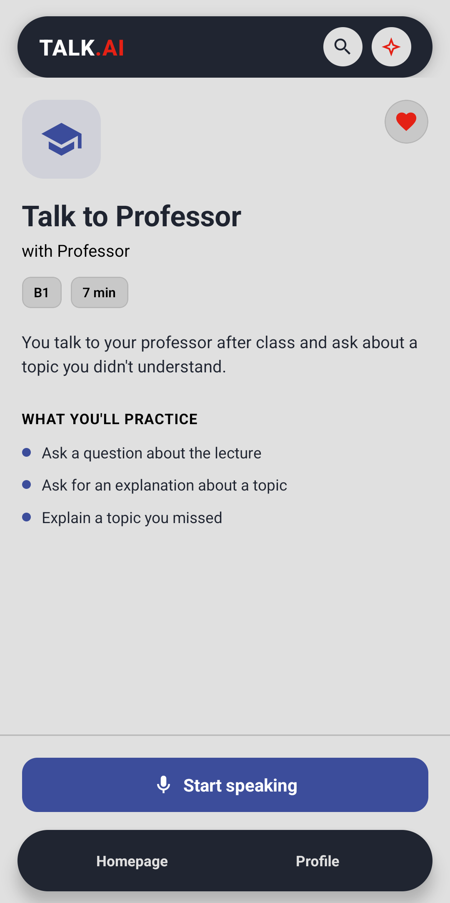 |  | 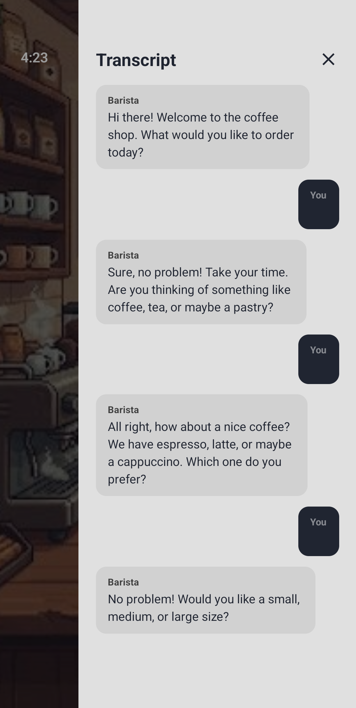 |
|           Favorited and ready to start            |     Push-to-talk call with the AI barista     |    Transcript panel opened during the call    |

### Feedback and progress

|                     Feedback                      |                Feedback transcript                | Profile | History |
|:-------------------------------------------------:|:-------------------------------------------------:|:---:|:---:|
|  | 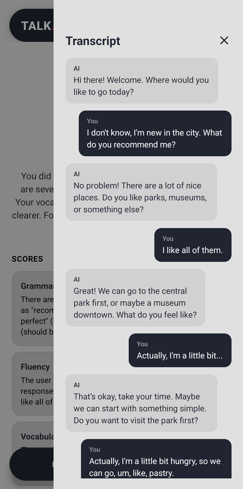 | 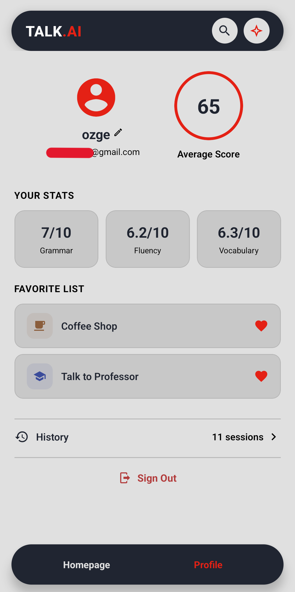 | 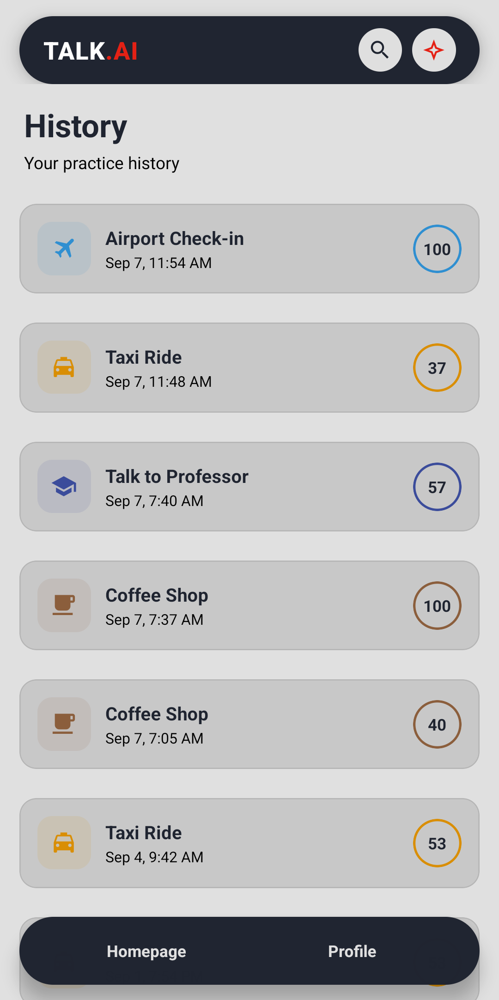 |
|         Overall score and per-skill notes         |          Full transcript of the session           | Averages and favorites | Every past session with its score |

## Scenarios

| # | Scenario | AI role | Level | Access |
|---|---|---|---|---|
| 1 | Taxi Ride | Taxi driver | A2 | Free |
| 2 | Coffee Shop | Barista | A1–A2 | Free |
| 3 | Talk to Professor | Professor | B1 | Free |
| 4 | Football With Friends | Friend / teammate | B1 | Free |
| 5 | Airport Check-in | Airline staff | A2 | Premium |
| 6 | Job Interview | Interviewer | B1–B2 | Premium |

## Tech stack

| Area | Tools |
|---|---|
| Mobile app | Expo SDK 52, React Native 0.76, TypeScript, Expo Router |
| Voice | react-native-webrtc, react-native-incall-manager |
| Backend | Django + Django REST Framework |
| AI | OpenAI Realtime (`gpt-realtime-mini`) for the conversation, `gpt-4o-mini` for feedback |
| Data and auth | Supabase (Postgres, Auth, Row Level Security) |
| Payments | RevenueCat (Test Store / sandbox) |
| Push notifications | OneSignal |
| Analytics | Amplitude |
| Builds | EAS Build, ngrok for exposing the backend to the APK |

## How it works

```
Expo app ──POST /api/realtime/token/──▶ Django ──▶ OpenAI (short-lived session key)
   │
   ├── WebRTC call with that key ──▶ OpenAI Realtime API (live audio + transcript)
   │
   └── End Session ──POST /api/realtime/feedback/──▶ Django ──▶ gpt-4o-mini (JSON feedback)
          │
          └── save session ──▶ Supabase (RLS-protected)
```

Some decisions behind this design:

- **Two separate AI calls.** The realtime model only plays its role. Feedback comes from a second model call with a JSON Schema and a scoring rubric, so scores use the full 1–10 range instead of clustering around the middle.
- **Push-to-talk instead of voice detection.** Automatic turn detection kept triggering on background noise, so it is turned off and the app commits the audio when the mic button is released.
- **Scenario goals guide the AI without becoming a checklist.** Each scenario's goals are added to the system prompt with an instruction to weave them into the conversation naturally.
- **No OpenAI key in the app.** The API key only lives on the backend. The app gets a short-lived key for each session.
- **Row Level Security is the access boundary.** Every Supabase table is protected by `auth.uid() = user_id` policies, not by filtering on the client.
- **Purchases and push follow the account, not the device.** RevenueCat and OneSignal are both logged in with the Supabase user id when the auth state changes.

## Project structure

```
TalkAI/
├── app/                     # Expo Router screens
│   ├── (tabs)/index.tsx     # home: grid, filters, favorites
│   ├── (tabs)/profile.tsx   # session history list
│   ├── scenario/[id].tsx    # scenario detail
│   ├── scenario/live.tsx    # live voice call
│   ├── feedback/result.tsx  # feedback screen
│   ├── history/[id].tsx     # past session detail
│   ├── account.tsx          # profile screen
│   └── auth.tsx             # sign in / sign up
├── components/              # FeedbackView, PremiumPaywall, TranscriptModal
├── contexts/                # AuthContext, SearchContext
├── hooks/useFavorites.ts    # shared favorites state
├── constants/               # scenarios, styles, layout
├── lib/                     # supabase, profile, purchases, analytics, sessionStorage
├── backend/                 # Django project (token + feedback endpoints)
├── plugins/                 # custom Expo config plugins
├── screenshots/             # images used in this README
├── schema.sql               # Supabase tables, RLS policies, triggers
└── eas.json                 # EAS Build profiles
```

## Running the APK

The APK in [Releases](../../releases) talks to a Django backend that runs on my machine and is exposed through ngrok. It only works while that backend is running, so it is meant for demos rather than everyday use. To try the app on your own, run the backend yourself (see below) and build your own APK pointed at it.

## Running it locally

### Requirements

- Node.js and npm
- Python 3.10+
- An Android device or emulator
- Accounts for OpenAI, Supabase and RevenueCat (OneSignal and Amplitude are optional)

The app uses native modules such as `react-native-webrtc`, so it needs a development build. It does not run in Expo Go.

### 1. Supabase

Create a project at [supabase.com](https://supabase.com), run `schema.sql` in the SQL Editor and copy the Project URL and anon key from Project Settings → API.

### 2. Backend

```bash
cd backend
python -m venv venv
source venv/bin/activate        # Windows: venv\Scripts\activate
pip install -r requirements.txt
cp .env.example .env            # set OPENAI_API_KEY
python manage.py migrate
python manage.py runserver 0.0.0.0:8000
```

### 3. App

```bash
npm install
cp .env.example .env
npm run android
```

Variables in `.env`:

| Variable | Description |
|---|---|
| `EXPO_PUBLIC_BACKEND_URL` | Backend URL (your LAN IP, or an ngrok domain) |
| `EXPO_PUBLIC_SUPABASE_URL` | Supabase project URL |
| `EXPO_PUBLIC_SUPABASE_ANON_KEY` | Supabase anon key |
| `EXPO_PUBLIC_REVENUECAT_API_KEY` | RevenueCat API key |
| `EXPO_PUBLIC_AMPLITUDE_API_KEY` | Amplitude API key (optional) |

The OneSignal App ID goes into `app.json` under `extra.oneSignalAppId`.

<details>
<summary><b>Optional: push notifications (OneSignal)</b></summary>

1. Create a free app at [onesignal.com](https://onesignal.com).
2. Create a Firebase project, add an Android app with the package name `com.olcekciozge.talkai` and put `google-services.json` in the project root.
3. In Firebase, go to Project Settings → Cloud Messaging → Manage Service Accounts, create a JSON key and upload it to OneSignal's Google Android (FCM) settings.
4. Copy the OneSignal App ID into `app.json`.
5. In OneSignal, open Messages → Journeys → Re-engagement, set the entry segment to "Last Session greater than 24 hours ago", add one push notification step and set the Journey live.

The daily reminder is configured entirely in the OneSignal dashboard, no backend code is needed.

</details>

<details>
<summary><b>Optional: analytics (Amplitude)</b></summary>

Create a project at [amplitude.com](https://amplitude.com) and put its API key into `.env` as `EXPO_PUBLIC_AMPLITUDE_API_KEY`. `lib/analytics.ts` sets up the SDK and sends events automatically. You can check them in Amplitude's User Look-Up or Event Explorer.

</details>

<details>
<summary><b>Building a standalone APK with ngrok</b></summary>

A LAN IP baked into the APK only works on that one Wi-Fi network. A free static ngrok domain stays the same on any network.

1. Sign up at [ngrok.com](https://ngrok.com), reserve a free static domain (for example `your-name.ngrok-free.dev`) and run `ngrok config add-authtoken <TOKEN>`.
2. Start the backend with `python manage.py runserver`.
3. In a second terminal, start the tunnel:
   ```bash
   ngrok http --url=your-name.ngrok-free.dev 8000
   ```
4. Set the URL locally in `.env`:
   ```
   EXPO_PUBLIC_BACKEND_URL=https://your-name.ngrok-free.dev
   ```
5. Set it on EAS too, because EAS builds read their own stored variables, not your local `.env`:
   ```bash
   npx eas-cli env:update --name EXPO_PUBLIC_BACKEND_URL \
     --value "https://your-name.ngrok-free.dev" --environment preview
   npx eas-cli env:list        # check before building
   ```
6. Build:
   ```bash
   npx eas-cli build --profile preview --platform android
   ```

The app already sends the `ngrok-skip-browser-warning` header, so ngrok's warning page doesn't get in the way. The backend and the tunnel must stay running for the APK to work.

</details>

## Technical notes

The `android/` folder is regenerated on every EAS build, so manual edits to native files are lost. The native changes this project needs live in custom config plugins under `plugins/`:

| Plugin | Why it exists |
|---|---|
| `withDebuggableManifest.js` | RevenueCat only accepts a Test Store key when the native `android:debuggable` flag is set. Without it, the release APK closes on launch. |
| `withDisableHardcodedDebugModeLint.js` | Turns off the Android Lint check that would otherwise fail the release build because of the flag above. |
| `withSkipKotlinMetadataVersionCheck.js` | OneSignal's Android libraries are compiled with a newer Kotlin version than React Native 0.76 uses. This adds `-Xskip-metadata-version-check` instead of upgrading Kotlin, which breaks the Gradle plugin. |

Two packages are pinned to older versions on purpose:

- `react-native-onesignal@5.3.6`: version 5.4 and later need React Native 0.79+ and crash at startup on 0.76.
- `onesignal-expo-plugin@1.3.2`: version 2.x needs Expo SDK 53+.

These pins should be revisited when the project moves to Expo SDK 53.

## Known limitations

- Android only. iOS support exists in code but has not been tested (no Mac or Apple Developer account was available).
- Email and password sign-in only, no Google or Apple sign-in.
- Payments run in RevenueCat's sandbox / Test Store only.
- Fluency is scored from the transcript text, not from the audio.
- Only OpenAI Realtime is supported as the voice model.
- The backend runs with `DEBUG = True` and `ALLOWED_HOSTS = ['*']`. That is fine for a demo, but while the ngrok tunnel is open the backend is reachable from the internet.
- `android:debuggable` is forced to `true` in release builds for the RevenueCat Test Store key. This has to change before a real store release.
- Analytics events are sent from the client only, so they are good for usage insights but not as a source of truth.
- The daily reminder is the same for every inactive user, not personalized per scenario or streak.
- Swiping back on the live call screen skips the end-call confirmation, only the End Session button asks for it.
- `transcriptionKeywords` in `constants/scenarios.ts` is defined but not used yet.